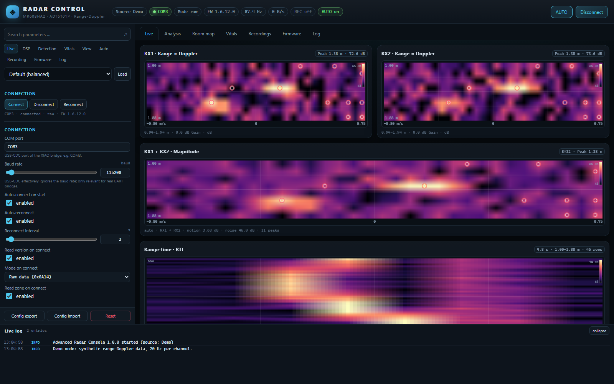
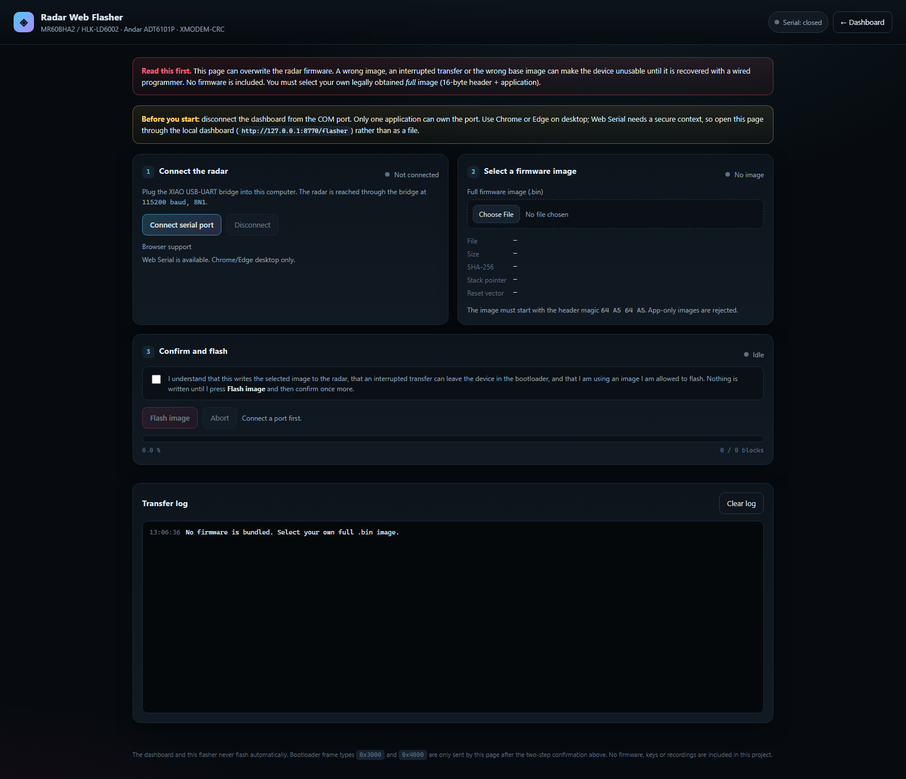

# MR60BHA2 Radar Console

Local live dashboard and browser-based Web Flasher for the **MR60BHA2**
(rebranded **Hi-Link HLK-LD6002**, Andar **ADT6101P** 60 GHz radar) connected
through a **Seeed Studio XIAO ESP32** USB-UART bridge.

The dashboard reads the radar's complex range-Doppler data on both receive
channels, processes it on the PC, and renders it with modern visualization
methods — heatmaps, multispectral fusion, range-time maps, an interactive 3D
surface, detection overlays, and vital-sign analysis. Nearly every parameter can
be changed live, and an automatic mode adapts contrast, thresholds, view range,
and raw/track operation on its own.

<p align="center">
  
</p>

> The screenshot shows **demo mode** with synthetic data — no radar is required
> to explore the interface.

---

## Features

- **Dual-channel raw data** — RX1 (`0x0A32`) and RX2 (`0x0A34`), 8 × 32 complex
  int16 I/Q values per frame, 8 / 16 / 32 rows selectable (firmware permitting)
- **Five heatmap modes** — magnitude, RGB fusion of both channels, frame-to-frame
  motion, SNR above the noise floor, and RX1 − RX2 difference
- **Modern rendering** — gamma tone mapping, histogram equalization, adjustable
  persistence/afterglow, auto contrast with percentiles, seven colormaps
- **Range-time heatmap (RTI)** — ~20 s of history, own contrast normalization
- **Interactive 3D surface** — drag to rotate, wheel to zoom, double-click to
  reset, Lambert shading, wireframe, auto-rotation, hover readout
- **Detection** — local-maximum or CFAR, noise estimation, DC exclusion, peak
  spacing, detection overlay, target tracking with trails
- **Vitals** — phase unwrapping, breathing and heart bands, FFT spectrum
- **Room map** — x/y point cloud with adjustable map size and target markers
- **Live parameter drawer** — searchable, grouped, applied immediately, persisted
  to `advanced_dashboard_config.json`; presets and automatic mode
- **Recording and export** — NPZ sessions, snapshots, CSV export, replay at
  adjustable speed
- **Firmware vault and studio** — store your own original image, build a tuned
  image from it in three steps, verify SHA-256; never flashes
- **Web Flasher** — drives the bootloader from Chrome/Edge via Web Serial and
  XMODEM-CRC, with two-step confirmation and abort
- **Works without hardware** — `--demo`, `--replay`, and `--selftest`

---

## Hardware

| Part | Notes |
|---|---|
| MR60BHA2 / HLK-LD6002 | Andar ADT6101P, ARM Cortex-M3, 2 TX / 2 RX, 58–62 GHz |
| Seeed Studio XIAO ESP32 | USB-CDC bridge between the PC and the radar UART |
| USB cable | Data cable, not charge-only |

### Where to buy

| <a href="https://espsoup.com/go/mr60bha2"></a> |
|:---:|
| **Seeed Studio MR60BHA2 60 GHz mmWave kit** |
| XIAO ESP32-C6 + HLK-LD6002 radar, ready to use as the bridge described here |
| [View on Amazon](https://espsoup.com/go/mr60bha2) |

USB-C data cable: [Amazon](https://espsoup.com/go/cable1) · [AliExpress](https://s.click.aliexpress.com/e/_c3qthcml)

<sub>**Ad** · affiliate links: Amazon, AliExpress. I may earn a commission on qualifying purchases at no extra cost
to you. As an Amazon Associate I earn from qualifying purchases. Product photo from Amazon. Check the product details
before you buy.</sub>

Wire the radar UART to the XIAO (radar TX → XIAO RX, radar RX → XIAO TX, common
ground) and power the module according to its datasheet. The bridge enumerates
as a COM port on Windows (for example `COM3`).

The radar firmware uses a **1,388,889 baud** UART link between the radar and the
bridge. The USB-CDC link to the PC ignores the configured baud rate; it only
matters for a real UART bridge.

---

## Requirements

- Python **3.9+**
- `numpy`, `pyserial`
- Chrome or Edge on desktop for the Web Flasher (Web Serial API)

```bat
python -m pip install -r requirements.txt
```

---

## Quick Start

```bat
:: Live radar on COM3, browser opens automatically
python -I advanced_dashboard.py --port COM3

:: No hardware: synthetic range-Doppler data
python -I advanced_dashboard.py --demo

:: Replay a recorded NPZ session at 2x speed
python -I advanced_dashboard.py --replay recordings/session.npz --replay-speed 2

:: Check backend, frontend, and flasher without starting the server
python -I advanced_dashboard.py --selftest
```

Default address: **http://127.0.0.1:8770** — the server binds to `127.0.0.1`
only and is not reachable from the network.

| Option | Meaning |
|---|---|
| `--port COMx` | serial port (overrides the saved configuration) |
| `--baud N` | baud rate for real UART bridges (USB-CDC ignores it) |
| `--http N` | HTTP port (default `8770`) |
| `--host ADDR` | bind address (default `127.0.0.1`) |
| `--demo` | synthetic data, no hardware |
| `--replay FILE` | play back an NPZ recording |
| `--replay-speed F` | replay speed multiplier (default `1.0`) |
| `--config FILE` | alternative configuration file |
| `--no-open` | do not open the browser |
| `--no-auto-connect` | do not connect on startup |
| `--selftest` | run checks and exit |

### Keyboard shortcuts

| Key | Action |
|---|---|
| `1` … `7` | Live, Analysis, Room Map, Vitals, Recordings, Firmware, Log |
| `A` | toggle automatic mode |
| `C` | connect / disconnect |

---

## The Seven Views

| Tab | Content |
|---|---|
| **Live** | RX1/RX2 heatmaps, multispectral view, range/Doppler profiles, waterfall, RTI, 3D surface, status cards |
| **Analysis** | large heatmap in the current mode and a large range-time map |
| **Room Map** | x/y detections, target markers, trails, adjustable map size |
| **Vitals** | respiration/heart rate, phase trace, spectra |
| **Recordings** | start/stop, snapshot, CSV export, file list |
| **Firmware** | back up the original, build a tuned image, manifest and hashes, flash instructions |
| **Log** | event log, parser statistics, frame types, radar debug text |

The parameter drawer on the right covers **Connection**, **Radar Parameters**,
**Raw Data / Calibration**, **Filters / Display**, **Stream / Waterfall / 3D**,
**Detection**, **Tracking**, **Vitals**, **Visibility**, **Map / View**,
**Automation**, and **Recording**. Firmware patch parameters live in the
**Firmware** tab.

### Automatic mode

One switch (or `A`) enables auto contrast, adaptive detection thresholds,
automatic view range and map size, raw-peak fallback targets, optional auto
gain, raw/track switching based on signal presence, and automatic recording.
It changes **PC-side** processing and runtime modes only — never firmware.

### Presets

`Default (balanced)`, `Sensitive` (weak motion), `Far` (long range), `Raw`
(maximum raw detail), `Vitals` (phase), `Debug` (everything on, CFAR, 40 peaks).

---

## Web Flasher

Open **http://127.0.0.1:8770/flasher** (also linked from the dashboard header
and the Firmware tab).

<p align="center">
  
</p>

The flasher runs entirely in the browser using the **Web Serial API**. It does
not use the Python backend for serial access, and it **ships no firmware**.

### Before you start

1. **Disconnect the dashboard** from the COM port — only one application can
   own the port.
2. Use **Chrome or Edge on desktop**. Firefox and Safari do not support Web
   Serial.
3. Open the page through `http://127.0.0.1:8770/flasher` (or HTTPS). Web Serial
   requires a secure context; opening the HTML file directly will not work.
4. Have your own legally obtained **full firmware image** ready — a 16-byte
   header followed by the application. App-only images are rejected.

### Flashing

1. Click **Connect serial port** and choose the XIAO's COM port.
2. Select the `.bin` image. The header is validated (magic `64 A5 64 A5`, stack
   pointer in SRAM, Thumb reset vector inside the image) and its SHA-256 is shown.
3. Tick the acknowledgement checkbox. **Flash image** becomes available only
   when a port is open and the image is valid.
4. Press **Flash image** and accept the second confirmation.

The page sends TinyFrame type `0x3000`, waits for the bootloader's `C` prompts,
transfers with **XMODEM-CRC** (128-byte blocks, `0x1A` padding, CRC16-XMODEM,
16 retries, 60 s per block), sends `EOT`, and then queries the version
(`0xFFFF`) up to five times.

**Abort** stops the transfer. The device may remain in the bootloader — reconnect
and flash again. A wrong image, an interrupted transfer, or the wrong base image
can make the device unusable until it is recovered with a wired programmer.

> The dashboard itself never flashes. Bootloader frame types `0x3000` and
> `0x4000` are blocked in the dashboard runtime; only this page sends `0x3000`,
> after two explicit confirmations.

---

## Build Your Own Firmware

The **Firmware** tab is a three-step studio: back up the original, build a tuned
image, then flash it yourself. Every step is local; the dashboard never opens
the bootloader and never flashes.

### Step 1 — Secure the original firmware

> **The ADT6101P bootloader is write-only over UART.** No command reads the
> flash back, and the vendor OTA tool has no dump function. A true chip backup
> therefore requires an **external SWD programmer** (read protection is unknown;
> it may be locked). Otherwise, keep a legally obtained **vendor full image** as
> your base — that is the practical path for most users.

The **firmware vault** (`firmware_vault/`) stores immutable copies of images you
import:

| Kind | Recognised by | Flashable | Build base |
|---|---|---|---|
| **full** | OTA magic `64 A5 64 A5` + 16-byte header | yes | yes |
| **app** | plausible vector table, no header | no | no |
| **raw** | anything else (for example an SWD readout) | no | no |

Import through the tab or the CLI. Each image is validated (stack pointer in
SRAM, Thumb reset vector inside the image), stored under a timestamped ID, and
deduplicated by SHA-256. Backups are kept even when they cannot be flashed.

```bat
python -I firmware_vault.py inspect IMAGE.bin
python -I firmware_vault.py import IMAGE.bin --source vendor-download
python -I firmware_vault.py import DUMP.bin --source swd-dump --note "SWD readout"
python -I firmware_vault.py list
python -I firmware_vault.py verify IMAGE_ID
```

### Step 2 — Build a tuned image

Select a **full** vault image as the build base, set the patch parameters in the
sidebar **Firmware** panel, and press **Build tuning image**. The result is
written to `firmware_out/<timestamp>_<base>/` with a manifest of every offset,
old and new byte, output SHA-256, and the expected UART load. Nothing is
flashed.

Some settings cannot be changed at runtime and require a patched image:

| Parameter | Values | Note |
|---|---|---|
| `fw_rows` | 8 / 16 / 32 | 32 rows overload the UART at ~20 Hz |
| `fw_tia` | 6 / 12 / 18 dB | gain, untested |
| `fw_vga` | 15 / 18 / 20 | gain, untested |
| `fw_pa` | 10 / 12 / 15 | PA bias, RF-relevant |
| `fw_hpf` | 150 / 400 kHz | high-pass filter, untested |

The UART baud mode handles the difference between the stock image and this
project:

| Mode | Effect |
|---|---|
| `auto` (default) | patches the stock 115200 baud clock literal to 1,388,889; an already-patched base is left unchanged |
| `keep` | leaves the stock baud rate untouched |
| `1382400` | requires the fast literal and refuses an unknown state |

`patch_raw_window.py` can also be used directly. It patches **only previously
verified byte sites**, refuses unknown images unless you explicitly allow them,
and contains no flash code:

```bat
python -I patch_raw_window.py --base-full YOUR_FULL_IMAGE.bin --rows 16
python -I patch_raw_window.py --base-full custom.bin --allow-unknown-base --rows 16 --baud auto
python -I patch_raw_window.py --rows 16 --tia 12 --allow-rf
```

The first two forms take any full image. The legacy form without `--base-full`
expects these files in the project directory (they are **not** included in this
repository):

```
mr60bha2_v1.6.12_app@0x8000_baud1382400.bin
MR60BHA2_eeprom_1.6.12_baud1382400.bin
```

A base that already contains tuning patches is rejected — use an unmodified
original. Images with an unrecognised SHA-256 need the **Allow unknown base**
checkbox; only enable it after verifying every patch offset yourself.

**TIA and VGA must not be increased at the same time.** RF patches are untested;
they can change reception, range, and regulatory compliance of the device.

### Step 3 — Flash it yourself

Download the generated **full** image from the manifest and open the
**Web Flasher**. It validates the header and SHA-256 and sends the image only
after two explicit confirmations. A failed update can leave the radar in the
bootloader; keep the original image at hand.

### UART load

| Rows | Range | Payload per frame | Approx. rate |
|---|---|---|---|
| 8 | 1.0 m | 1024 B | 40.5 kB/s |
| 16 | 2.0 m | 2048 B | 80.6 kB/s |
| 32 | 4.0 m | 4096 B | 160.7 kB/s (overload) |

The link carries 1,388,889 baud ≈ 138.9 kB/s, and both channels stream
simultaneously.

---

## What This Repository Does Not Contain

This is a **dashboard and tooling** project. It deliberately excludes:

- radar firmware, the vendor SDK, decompiled code, and flash backups
- vault copies (`firmware_vault/`) and generated images (`firmware_out/`)
- recorded raw data (`*.npz`), snapshots, and tuning output
- `advanced_dashboard_config.json` and any local configuration
- logs, dumps, credentials, API keys, and Wi-Fi data

`.gitignore` blocks `*.bin`, `*.npz`, `firmware_vault/`, `firmware_out/`, the
configuration file, and working directories. **Never commit a flash backup** —
it can contain NVS data such as Wi-Fi credentials.

---

## Project Layout

```
advanced_dashboard.py     Backend: serial reader, DSP, HTTP+SSE, recording, patch generator
advanced_dashboard.html   Frontend: canvas renderer, firmware studio, UI, automation
webflasher.html           Web Serial flasher (XMODEM-CRC, no firmware)
radar_tf.py               TinyFrame protocol helper and CLI probe
firmware_vault.py         Image validation, immutable vault, SHA-256 (never flashes)
patch_raw_window.py       Tuning image generator (never flashes)
tests/                    Unit tests for vault and patch pipeline (synthetic images)
requirements.txt          Python dependencies
docs/                     Screenshots for this README
```

Working directories are created on demand: `recordings/`, `snapshots/`,
`tuning/`, `firmware_vault/`, and `firmware_out/`. The dashboard's HTTP
endpoints are `/`, `/flasher`, `/api/state`, `/api/stream`, `/api/config`,
`/api/action`, `/api/download`, `/api/firmware/list`, `/api/firmware/image`,
`/api/firmware/import`, and `/api/firmware/verify`.

---

## Troubleshooting

| Problem | Cause / Solution |
|---|---|
| `COM3 in use` | close the other program (dashboard, Web Flasher, Serial Monitor) |
| No raw data | radar is in Track mode → send **Raw On** (`0x0A14`); the dashboard retries up to two times after boot |
| No frames at all | wrong COM port, bridge not connected, wrong bridge baud rate |
| `numpy` / `pyserial` missing | `python -m pip install -r requirements.txt` |
| Port 8770 in use | `--http 8771` |
| Empty maps in demo | synthetic targets need a few seconds |
| RTI stays empty | check `raw.ok` and `profiles.range_combined` |
| Web Flasher: no serial support | use Chrome/Edge desktop and open the page via localhost |
| Web Flasher: port busy | disconnect the dashboard first |
| Firmware tab: no build base | import a **full** image into the vault; images are not bundled |
| Firmware tab: "not a recognised official base" | verify every patch offset, then enable **Allow unknown base** |
| Firmware tab: "already contains tuning patches" | use an unmodified original as the build base |
| Need a true chip dump | the UART bootloader cannot read flash; use SWD or the vendor image |

Run the self-test for a quick diagnosis:

```bat
python -I advanced_dashboard.py --selftest
```

```json
{"ok": true, "rows": 8, "cols": 32, "detections": 12, "json_bytes": 24039,
 "html_exists": true, "html_markers": true, "flasher_exists": true,
 "flasher_markers": true, "patch_script": true, "vault_module": true,
 "vault_ok": true, "firmware_build": true, "firmware_error": null,
 "version": "1.6.12.0"}
```

Run the unit tests (synthetic images only, no vendor firmware required):

```bat
python -I -m unittest discover -s tests -v
```

---

## Limitations

- The radar delivers **post-FFT** range-Doppler values (`0x0A32`/`0x0A34`), not a
  pre-FFT ADC cube. A full raw cube is not available over this UART link.
- Only **two receive channels** and no height information. The “3D” view is
  range × Doppler × level, not a physical height map.
- 32-row raw mode exceeds the UART capacity at the stock frame rate and needs a
  frame-rate patch or produces dropped frames.
- Web Serial is limited to Chromium-based desktop browsers.
- The dashboard is a local analysis tool, not a certified measurement device.

---

## Third-Party Notice

MR60BHA2, HLK-LD6002, Andar, and XIAO are trademarks of their respective
owners. This project is not affiliated with or endorsed by them. No vendor
firmware, SDK, or decompiled code is distributed here. Firmware images remain
the responsibility of the user; obtain them legally and comply with local radio
regulations.

RF patches change transmitter behaviour and are **untested**. Flashing is done
at your own risk. The software is provided “as is”, without warranty of any
kind.
